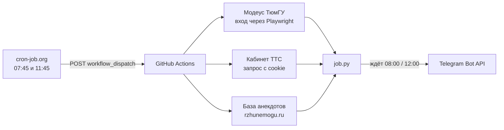

# 🤖 tgbobik — личный Telegram-помощник студента

Каждое утро сам присылает **расписание пар из Модеуса ТюмГУ** и **баланс транспортной карты ТТС**, а в полдень — **свежий анекдот без повторов**. Работает бесплатно, без своего сервера и без включённого компьютера.


---


**Update.** После многочисленных тестов и банки пива запускаем бота в cron-job. 
---

## ✨ Что умеет

| Время (Тюмень) | Что приходит |
|---|---|
| **08:00** | 📅 Расписание на сегодня: время, предмет, тип занятия, аудитория с адресом корпуса, преподаватель + 💳 баланс карты ТТС |
| **12:00** | 😄 Анекдот (по выходным — афоризм или стишок), без повторов |

Пример утреннего сообщения:

```
Доброе утро!

📅 Сегодня, 12.10

⏰ 15:55 - 17:25
📚 Маркетинговые исследования ... | Определение проблемы ...
🧪 Практическое занятие
🏫 115, Корпус-08 (ул. Ленина, 67)
👨‍🏫 Фамилия Имя Отчество

💳 Баланс карты: 666,75 ₽
```

---

## 🧩 Как это устроено



1. **cron-job.org** в 07:45 и 11:45 по городу мгновенно запускает нужный workflow через GitHub API.
2. **GitHub Actions** поднимает окружение, собирает данные и ждёт ровно 08:00 (12:00).
3. **job.py** отправляет сообщение через Telegram Bot API.

### Почему не обычное расписание GitHub?

Встроенный `schedule` у GitHub работает «по возможности»: на практике запуски опаздывали на **4–7 часов** (сообщение «доброе утро» приходило в 14:40). Поэтому основной запуск сделан **снаружи**, через cron-job.org: он стартует в нужную минуту. Встроенные cron-запуски GitHub оставлены как страховка.

---

## 📁 Структура

| Файл | Назначение |
|---|---|
| `job.py` | Точка входа для Actions: `python job.py morning` / `python job.py joke` |
| `modeus_client.py` | Автоматический вход в Модеус (Playwright), запрос событий, оформление пар |
| `tts_client.py` | Баланс карты ТТС из личного кабинета по сохранённой сессии |
| `jokes.py` | Получение анекдотов, фильтры, защита от повторов |
| `.github/workflows/morning.yml` | Утреннее задание |
| `.github/workflows/joke.yml` | Полуденное задание |
| `requirements.txt` | Зависимости (`requests`, `playwright`) |
| `jokes_state.json` | Отпечатки уже присланных анекдотов (последние 1000, ~11 КБ) |
| `morning_sent.txt`, `joke_sent.txt` | Отметки «сегодня уже отправлено» (чтобы запасные запуски не дублировали) |

---

## 🛠 Стек

Python 3.12 · Playwright (Chromium) · requests · GitHub Actions · cron-job.org · Telegram Bot API

---

## 🔐 Настройка

### 1. Секреты репозитория
`Settings → Secrets and variables → Actions → New repository secret`

| Секрет | Что внутри |
|---|---|
| `BOT_TOKEN` | Токен бота от @BotFather |
| `CHAT_ID` | Ваш числовой id в Telegram |
| `CARD_NUMBER` | Номер карты ТТС |
| `MODEUS_LOGIN` / `MODEUS_PASSWORD` | Учётка Модеуса |
| `TTS_COOKIE` | Команда `curl` (Copy as cURL) запроса `ajax_card.php` из личного кабинета ТТС или строка cookie |

### 2. Внешний запуск (cron-job.org)
Два задания, часовой пояс `Asia/Yekaterinburg`, метод **POST**:

| Задание | Время | URL |
|---|---|---|
| morning | 07:45 | `https://api.github.com/repos/<user>/<repo>/actions/workflows/morning.yml/dispatches` |
| joke | 11:45 | `https://api.github.com/repos/<user>/<repo>/actions/workflows/joke.yml/dispatches` |

Тело: `{"ref":"main","inputs":{"wait":"true"}}`
Заголовки: `Authorization: Bearer <fine-grained token с правом Actions: Read and write>`, `Accept: application/vnd.github+json`, `Content-Type: application/json`.

`wait: true` заставляет скрипт дождаться ровно 08:00 / 12:00. Ручной запуск кнопкой **Run workflow** отправляет сообщение сразу.

---

## 🧯 Известные ограничения

- **Cookie ТТС протухают.** Когда баланс начнёт приходить с ошибкой «сессия истекла», нужно заново войти в кабинет и обновить секрет `TTS_COOKIE`.
- **Баланс в кабинете ТТС может отставать** на несколько дней: сайт сам предупреждает об этом. Бот показывает то, что видит на сайте.
- **Вход в Модеус** идёт с зарубежного сервера GitHub, поэтому иногда может не пройти. В этом случае в сообщении будет пометка, а запасной запуск попробует ещё раз.
- Анекдоты берутся из внешней базы: если она недоступна, бот использует запасной список.

---

## 🛡 Безопасность

- В репозитории **нет** паролей, токенов и cookie: всё хранится в зашифрованных секретах GitHub.
- Токен для cron-job.org выдан только на один репозиторий и только на запуск workflow.
- Если токен бота или cookie где-то засветились, их нужно сразу перевыпустить (`/revoke` в @BotFather, повторный вход в кабинет ТТС).

---

## 🗺 Планы

- [ ] Картинки и мемы вместе с анекдотом
- [ ] Расписание на неделю и оценки по запросу
- [ ] Расписание друзей по фамилии
- [ ] Интерактивный режим с кнопками («Сегодня», «Завтра», «Неделя», «Баланс») на постоянном сервере

---

## ⚠️ Дисклеймер

Личный учебный проект. Не связан с ТюмГУ, Модеусом и ТТС и не претендует на официальность. Использует только данные владельца учётной записи. ЕСТЬ алтернатива от студента модеус бот который херачит для всех студентов. мой чисто развекалово.
